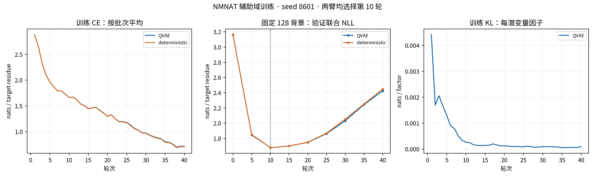

# NMNAT 辅助域 QVAE：训练、生成与计算评价

两个模型都学会了本次辅助域条件恢复任务，并产生了真实 KVP40 变体；当前结果没有显示 QVAE 在联合概率或候选供给方面优于同信息确定性模型。结果支持交付候选序列，不支持宣称完整 NatV 模型已经通过辅助训练得到改善。

## 模型与训练

输入来自 [PF01467 迁移资格分析](../../preprocessing/pf01467_8849/REPORT.md)：2,395 条训练域、1,684 条开发验证域，按 50% identity、80% 双向覆盖的域组划分；85 条风险序列不进入默认训练。来源包含 NMNAT、NadR、混合 EC、文本及未知注释，本次学习的是域序列分布，不把它们当作已实测的 NMNAT 功能标签。

QVAE 与确定性模型均从随机参数训练，冻结同一个本地 ESM-2，使用相同数据、任务和优化预算。QVAE 沿用完整目标后验、学习型条件先验、共享 16×8 Categorical 潜变量、RLOO 重构梯度及解析 KL。每臂 seed=8601、batch=32、3,000 步、40 轮；QVAE 每次使用 8 个离散样本。目标仅从可靠对应且属于标准 20 种氨基酸的位置选取；请求遮蔽 8/16/32 位，位置不足时缩小，并在实际记录中保留目标数量。具体参数见 `config/aux_qvae.yaml`。

每 5 轮在固定 128 条开发验证背景上选择权重：按 38 个域组均衡选背景，每背景一个固定 mask_16，QVAE 使用 16 个先验样本估计联合 NLL。选择分数按实际目标位点汇总，没有再使用来源记录权重；它不是全开发验证集的组均衡分数。两臂均保留 initial、best、last，正式生成与评价使用第 10 轮、750 步的 best。

| 固定选择子集 · nats/目标残基 | QVAE | 确定性 |
|---|---:|---:|
| 初始先验联合 NLL | 3.163430 | 3.160920 |
| 第 10 轮最佳值 | 1.679099 | 1.679424 |
| 第 40 轮末轮值 | 2.424411 | 2.449584 |

训练 CE 是每轮各批次指标的平均，目标掩码在 8/16/32 位之间切换；验证是固定条件下的联合 NLL，二者不应作为同一种损失直接相减。第 10 轮后训练 CE 继续下降、验证 NLL 回升，显示当前配置的过拟合。KL 曲线按潜变量因子计；`training_summary.json` 中选择子集的 `kl_mean` 是每序列全部因子的 KL 总和。

首次运行在第 22 步因 `X` 残基进入标签查找而失败，完成 21 步、约 9 秒，未保存权重。修复后未知残基不作为遮蔽目标，非目标位置的占位标签不进入损失；相关输入中有 10 条域含非标准残基、4 个可靠位置被排除。失败信息及 21 步记录保留在训练目录。初始验证行曾在训练后由已保存的 initial 指标补入曲线，数值与 initial checkpoint 和 `training_summary.json` 一致。

## 全开发验证集的概率比较

在 1,684 条域、5,052 个固定恢复条件上按域组均衡计分。QVAE 使用 64 个样本、4 次重复，分别估计后验重要性采样联合概率、直接先验采样联合概率和自身边缘独立概率；确定性模型计分精确。平均重构 CE 单独记录，未用它替代联合 NLL。

| 指标 · nats/目标残基 | 值 |
|---|---:|
| QVAE 后验重要性采样联合 NLL | 1.8743113 |
| QVAE 直接先验采样联合 NLL | 1.8741606 |
| QVAE 自身边缘独立 NLL | 1.8741889 |
| 确定性精确 NLL | 1.8744126 |

按 38 个域组配对 bootstrap 2,000 次，seed=8802。正差值表示 QVAE 或共享潜变量的分数更好。

| 差值 | 均值 | 95% 配对组区间 |
|---|---:|---:|
| 确定性 − QVAE 后验 IS | 0.0001013 | [−0.0011073, 0.0013153] |
| 确定性 − QVAE 先验 MC | 0.0002520 | [−0.0009473, 0.0014419] |
| QVAE 自身边缘 − 共享先验 | 0.0000283 | [−0.0000265, 0.0000885] |

三个区间都包含零，没有有意义的概率优势证据。QVAE 重要性采样平均 ESS 为 61.46/64，低于 10% 样本数的比例为零，最大归一化权重均值 0.0244；后验联合 NLL 的重复估计 MC 标准误为 0.0000909。后验 IS 和直接先验是同一分布的两种有限样本估计，它们的接近不证明后验与先验相同。

bootstrap 区间条件于本次训练 seed 和平均 MC 结果，不覆盖训练随机性或共同的有限样本对数偏差。128 条背景已用于选权重，最终计分群体是同一个开发验证集合，不能称独立测试；30% identity 层的远缘同源限制沿用数据报告。本次没有引入测试序列来改变这些判断。

## 生成与代表序列

两臂使用同一背景、掩码、draw 和残基采样均匀数，温度为 1，一次生成、不补采。辅助验证背景按域组均衡选择 128 条，每背景 3 个任务、每任务 16 次，共 6,144 次/臂。另以 KVP40 WT 的 NMNAT 4–181 为域上下文，8/16/32 位各 16 个位置集合、每集合 64 次，共 3,072 次/臂；域结果嵌回原 341 aa，域外序列保持 WT。

| 来源 | 模型 | 尝试 | 不同全长序列 | 超出首次的重复 | WT 返回 | 平均 Hamming |
|---|---|---:|---:|---:|---:|---:|
| 异源辅助背景提案 | QVAE | 6,144 | 6,117 | 27 | 7 | 10.980 |
| 异源辅助背景提案 | 确定性 | 6,144 | 6,114 | 30 | 6 | 10.971 |
| KVP40 WT 条件生成 | QVAE | 3,072 | 3,072 | 0 | 0 | 13.867 |
| KVP40 WT 条件生成 | 确定性 | 3,072 | 3,069 | 3 | 0 | 13.867 |

18,432 条记录均保留在分母，生成失败为零。逐条核对全长 341 aa、标准氨基酸、序列校验值及掩码外不变；两臂条件和残基随机数也逐行对应。KVP40 条件生成的真实替换数分别为 2–30、2–31。其四个 NMNAT 对应锚点至少一处改变的序列为 205/3,072 与 206/3,072，属于需进一步研究的变化，不是功能改善。

辅助背景分支只把相对异源原序列发生的生成替换投影回 WT；未变的异源残基不复制。它是跨背景的变化提案，不能当作从 `p(x|KVP40)` 抽到的序列，也不能将该分支的“新颖率”作为 KVP40 设计优势。下述正式代表序列只选自真实 KVP40 WT 条件生成分支。

每臂按五个问题选取已有序列：低编辑参照、L18I、K130R、F13Y+A134G、T135S；前三类保留四个 NMNAT 对应锚点，T135S 类保留另三个锚点。各类按真实 Hamming 最小、原候选 ID 破同分，不为填数量额外生成。得到 **10 条代表记录、9 条不同序列**；跨臂相同序列在 CSV 中标记，FASTA 去重。

其中两臂各有一条 F13Y+A134G 组合：QVAE_R04 含 13 处替换，对照 deterministic_R04 含 14 处替换，来自同一掩码与 draw；后者额外含 M33L。它们都含多处其他替换，不能隔离双替换效应。该组合的供给不是 QVAE 独有；与此前候选池的差异同时涉及训练群体、模型、域上下文和位置集合，不能归因于辅助训练的单一作用。

代表序列与研究问题见 [CSV](../../generation/aux_qvae_seed8601/representative_candidates.csv)，去重全长序列见 [FASTA](../../generation/aux_qvae_seed8601/representative_candidates.fasta)。本轮只有模板位点参考和序列评价：2QJO 用于 NMNAT 参照，2QJT/2R5W 未用于 NMNAT 四锚点；没有据此评判候选自身的口袋几何、结构质量或酶学性能。

## 计算成本与复现

单卡 RTX 5090 D，记录的计算段耗时为训练 747.2+389.9 秒、生成约 31.1 秒、全开发验证评价约 79.4 秒，合计约 20.8 分钟，另有首次失败约 9 秒。这些是计算函数记录的耗时，不是完整进程墙时或直接测量的 GPU 忙碌时长。CPU 配对统计、原始序列核对和绘图未启动新的模型采样。

配置为 `config/aux_qvae.yaml`；实际训练/生成实现对应提交 `ceeb69c`，概率评价对应 `b4bc28d` 与 `c9262f3`。权重在 `data/weights/aux_qvae/`，两份 best SHA256 分别为 `54f629d0fcbc948fa3069562a3c54f232b58adf1cf4102212fba1fa0c0707af8`、`3884a99806f43142aeb13966302515c03ea533cbf0df71fc6ec39513455aa9d1`；六份 initial/best/last 均已与训练摘要核对。输入与权重校验值、固定选择背景、原始训练曲线和失败记录在同名 `training/` 目录，逐条件概率与采样诊断在本目录的两模型子目录，完整生成记录在同名 `generation/` 目录。

`comparison.json` 保存逐域组差值、bootstrap 参数、生成统计、输入及实现 SHA。正式 CLI `aux-summary` 从现有训练、生成、评价目录重建这些统计并选择代表序列，不启动训练或生成；目标已有 `comparison.json` 时拒绝覆盖。训练、生成和评价分别通过 `aux-train`、`aux-generate`、`aux-evaluate` 执行。
