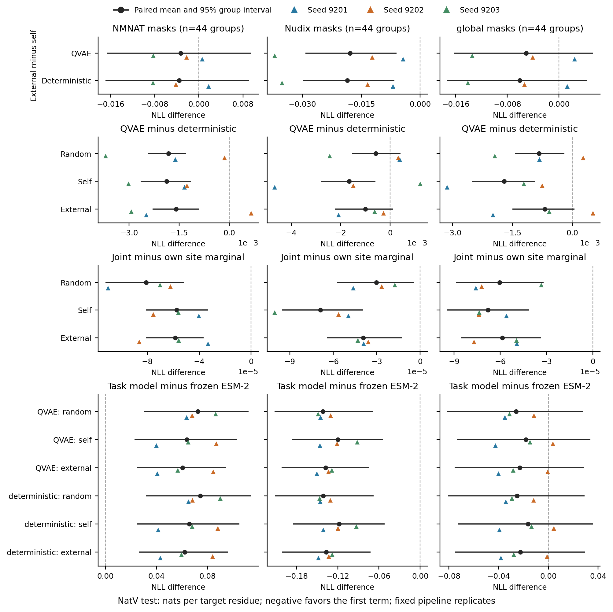

# NatV 六格条件预测比较

评价划分：test。差值为比较名称中前项减后项，单位为 nats/目标残基；负值表示前项 NLL 较低。主要问题是 NMNAT 的 external − self；其他区域、模型差异、与冻结 ESM-2 的差异及交互项为补充比较。

图中黑点先在每个序列组内平均配对训练重复，再对组等权汇总；横线为组 bootstrap 95% 区间。彩色三角为各完整训练重复的组均值，不是新增独立序列组。区间以这些已拟合模型为条件，未覆盖训练随机性或作多重比较调整。

各图列仅显示该区域的掩码，global 不是全部掩码的加权总体。坐标范围随比较变化；约 10⁻⁴ 的 joint − marginal 差值须结合另行输出的 Monte Carlo 精度分析，不能由区间与零的关系直接解释为有用的生成依赖。

| 比较 | 区域 | 组数 | 平均差值 | 95% 组区间 |
| --- | --- | ---: | ---: | --- |
| random:QVAE_minus_deterministic | NMNAT | 44 | -0.00182016 | [-0.00243759, -0.00128837] |
| random:QVAE_minus_deterministic | Nudix | 44 | -0.00058333 | [-0.00153014, +0.00041756] |
| random:QVAE_minus_deterministic | global | 44 | -0.00083433 | [-0.00144084, -0.00020305] |
| random:QVAE_minus_deterministic | linker | 44 | -0.00049931 | [-0.00226134, +0.00130938] |
| random:QVAE_minus_deterministic | random | 44 | -0.00181539 | [-0.00226220, -0.00135426] |
| random:joint_minus_site_marginal | NMNAT | 44 | -0.00008091 | [-0.00011224, -0.00005162] |
| random:joint_minus_site_marginal | Nudix | 44 | -0.00003016 | [-0.00005733, -0.00000455] |
| random:joint_minus_site_marginal | global | 44 | -0.00006051 | [-0.00008860, -0.00003182] |
| random:joint_minus_site_marginal | linker | 44 | -0.00002795 | [-0.00007368, +0.00001323] |
| random:joint_minus_site_marginal | random | 44 | -0.00018258 | [-0.00022720, -0.00014111] |
| self:QVAE_minus_deterministic | NMNAT | 44 | -0.00187366 | [-0.00264978, -0.00114990] |
| self:QVAE_minus_deterministic | Nudix | 44 | -0.00165596 | [-0.00280467, -0.00059858] |
| self:QVAE_minus_deterministic | global | 44 | -0.00170659 | [-0.00251078, -0.00094311] |
| self:QVAE_minus_deterministic | linker | 44 | -0.00149747 | [-0.00375492, +0.00057372] |
| self:QVAE_minus_deterministic | random | 44 | -0.00146727 | [-0.00200563, -0.00092021] |
| self:joint_minus_site_marginal | NMNAT | 44 | -0.00005729 | [-0.00008123, -0.00003327] |
| self:joint_minus_site_marginal | Nudix | 44 | -0.00006885 | [-0.00009539, -0.00003958] |
| self:joint_minus_site_marginal | global | 44 | -0.00006795 | [-0.00009450, -0.00004143] |
| self:joint_minus_site_marginal | linker | 44 | -0.00004398 | [-0.00009099, +0.00000127] |
| self:joint_minus_site_marginal | random | 44 | -0.00018092 | [-0.00022213, -0.00013984] |
| external:QVAE_minus_deterministic | NMNAT | 44 | -0.00158674 | [-0.00229002, -0.00089989] |
| external:QVAE_minus_deterministic | Nudix | 44 | -0.00100488 | [-0.00223711, +0.00011546] |
| external:QVAE_minus_deterministic | global | 44 | -0.00068937 | [-0.00150280, +0.00005264] |
| external:QVAE_minus_deterministic | linker | 44 | -0.00054546 | [-0.00256735, +0.00141637] |
| external:QVAE_minus_deterministic | random | 44 | -0.00104129 | [-0.00164841, -0.00045097] |
| external:joint_minus_site_marginal | NMNAT | 44 | -0.00005845 | [-0.00008120, -0.00003650] |
| external:joint_minus_site_marginal | Nudix | 44 | -0.00003933 | [-0.00006441, -0.00001283] |
| external:joint_minus_site_marginal | global | 44 | -0.00005868 | [-0.00008521, -0.00003348] |
| external:joint_minus_site_marginal | linker | 44 | -0.00006558 | [-0.00011213, -0.00002357] |
| external:joint_minus_site_marginal | random | 44 | -0.00012950 | [-0.00017166, -0.00008812] |
| QVAE:external_minus_self | NMNAT | 44 | -0.00330419 | [-0.01665814, +0.00946721] |
| QVAE:external_minus_self | Nudix | 44 | -0.01788774 | [-0.02920774, -0.00599933] |
| QVAE:external_minus_self | global | 44 | -0.00505158 | [-0.01627305, +0.00524415] |
| QVAE:external_minus_self | linker | 44 | +0.00380660 | [-0.01664550, +0.02375269] |
| QVAE:external_minus_self | random | 44 | -0.00301134 | [-0.01026149, +0.00519880] |
| QVAE:self_minus_random | NMNAT | 44 | -0.00872886 | [-0.02251192, +0.00473577] |
| QVAE:self_minus_random | Nudix | 44 | +0.02193293 | [+0.00241805, +0.03974132] |
| QVAE:self_minus_random | global | 44 | +0.00801256 | [-0.00489402, +0.02122022] |
| QVAE:self_minus_random | linker | 44 | +0.01971050 | [-0.00444221, +0.04305740] |
| QVAE:self_minus_random | random | 44 | +0.00295407 | [-0.00843782, +0.01412467] |
| QVAE:external_minus_random | NMNAT | 44 | -0.01203305 | [-0.02652380, +0.00080664] |
| QVAE:external_minus_random | Nudix | 44 | +0.00404519 | [-0.01026309, +0.01697590] |
| QVAE:external_minus_random | global | 44 | +0.00296098 | [-0.00647912, +0.01262889] |
| QVAE:external_minus_random | linker | 44 | +0.02351710 | [+0.00559522, +0.04190996] |
| QVAE:external_minus_random | random | 44 | -0.00005728 | [-0.00839980, +0.00866604] |
| QVAE:random_minus_frozen_esm2 | NMNAT | 44 | +0.07248747 | [+0.02997002, +0.11211565] |
| QVAE:random_minus_frozen_esm2 | Nudix | 44 | -0.14152436 | [-0.21183191, -0.06810942] |
| QVAE:random_minus_frozen_esm2 | global | 44 | -0.02608416 | [-0.08147853, +0.02766195] |
| QVAE:random_minus_frozen_esm2 | linker | 44 | -0.18900844 | [-0.28149919, -0.09556699] |
| QVAE:random_minus_frozen_esm2 | random | 44 | -0.03526772 | [-0.08333337, +0.01112266] |
| QVAE:self_minus_frozen_esm2 | NMNAT | 44 | +0.06375861 | [+0.02267150, +0.10301794] |
| QVAE:self_minus_frozen_esm2 | Nudix | 44 | -0.11959144 | [-0.18657257, -0.05432598] |
| QVAE:self_minus_frozen_esm2 | global | 44 | -0.01807160 | [-0.07381260, +0.03367452] |
| QVAE:self_minus_frozen_esm2 | linker | 44 | -0.16929794 | [-0.25988741, -0.07320360] |
| QVAE:self_minus_frozen_esm2 | random | 44 | -0.03231366 | [-0.07722985, +0.01105045] |
| QVAE:external_minus_frozen_esm2 | NMNAT | 44 | +0.06045442 | [+0.02451189, +0.09449625] |
| QVAE:external_minus_frozen_esm2 | Nudix | 44 | -0.13747918 | [-0.20182088, -0.07397368] |
| QVAE:external_minus_frozen_esm2 | global | 44 | -0.02312318 | [-0.07529997, +0.02874897] |
| QVAE:external_minus_frozen_esm2 | linker | 44 | -0.16549134 | [-0.25777642, -0.07213461] |
| QVAE:external_minus_frozen_esm2 | random | 44 | -0.03532500 | [-0.07940347, +0.00797414] |
| deterministic:external_minus_self | NMNAT | 44 | -0.00359112 | [-0.01691639, +0.00914189] |
| deterministic:external_minus_self | Nudix | 44 | -0.01853882 | [-0.02972289, -0.00658522] |
| deterministic:external_minus_self | global | 44 | -0.00606880 | [-0.01732547, +0.00439764] |
| deterministic:external_minus_self | linker | 44 | +0.00285459 | [-0.01845416, +0.02275327] |
| deterministic:external_minus_self | random | 44 | -0.00343732 | [-0.01036147, +0.00462557] |
| deterministic:self_minus_random | NMNAT | 44 | -0.00867535 | [-0.02262633, +0.00468644] |
| deterministic:self_minus_random | Nudix | 44 | +0.02300556 | [+0.00380016, +0.04074261] |
| deterministic:self_minus_random | global | 44 | +0.00888482 | [-0.00426020, +0.02216094] |
| deterministic:self_minus_random | linker | 44 | +0.02070866 | [-0.00357111, +0.04414473] |
| deterministic:self_minus_random | random | 44 | +0.00260595 | [-0.00861918, +0.01343026] |
| deterministic:external_minus_random | NMNAT | 44 | -0.01226647 | [-0.02675605, +0.00074584] |
| deterministic:external_minus_random | Nudix | 44 | +0.00446674 | [-0.00942845, +0.01723447] |
| deterministic:external_minus_random | global | 44 | +0.00281602 | [-0.00686854, +0.01264396] |
| deterministic:external_minus_random | linker | 44 | +0.02356325 | [+0.00566729, +0.04154521] |
| deterministic:external_minus_random | random | 44 | -0.00083137 | [-0.00883478, +0.00781606] |
| deterministic:random_minus_frozen_esm2 | NMNAT | 44 | +0.07430763 | [+0.03165747, +0.11415523] |
| deterministic:random_minus_frozen_esm2 | Nudix | 44 | -0.14094104 | [-0.21141725, -0.06769350] |
| deterministic:random_minus_frozen_esm2 | global | 44 | -0.02524983 | [-0.08080321, +0.02902322] |
| deterministic:random_minus_frozen_esm2 | linker | 44 | -0.18850913 | [-0.28018666, -0.09560022] |
| deterministic:random_minus_frozen_esm2 | random | 44 | -0.03345233 | [-0.08158461, +0.01334658] |
| deterministic:self_minus_frozen_esm2 | NMNAT | 44 | +0.06563228 | [+0.02469500, +0.10492823] |
| deterministic:self_minus_frozen_esm2 | Nudix | 44 | -0.11793548 | [-0.18489791, -0.05188546] |
| deterministic:self_minus_frozen_esm2 | global | 44 | -0.01636502 | [-0.07274313, +0.03567330] |
| deterministic:self_minus_frozen_esm2 | linker | 44 | -0.16780047 | [-0.25994844, -0.07084452] |
| deterministic:self_minus_frozen_esm2 | random | 44 | -0.03084639 | [-0.07565966, +0.01280389] |
| deterministic:external_minus_frozen_esm2 | NMNAT | 44 | +0.06204116 | [+0.02620227, +0.09615967] |
| deterministic:external_minus_frozen_esm2 | Nudix | 44 | -0.13647430 | [-0.20132296, -0.07235136] |
| deterministic:external_minus_frozen_esm2 | global | 44 | -0.02243381 | [-0.07514875, +0.02923746] |
| deterministic:external_minus_frozen_esm2 | linker | 44 | -0.16494588 | [-0.25787401, -0.07086812] |
| deterministic:external_minus_frozen_esm2 | random | 44 | -0.03428371 | [-0.07837441, +0.00921969] |
| external_minus_self:QVAE_minus_deterministic | NMNAT | 44 | +0.00028693 | [-0.00065539, +0.00122104] |
| external_minus_self:QVAE_minus_deterministic | Nudix | 44 | +0.00065108 | [-0.00059966, +0.00190930] |
| external_minus_self:QVAE_minus_deterministic | global | 44 | +0.00101722 | [+0.00002525, +0.00195973] |
| external_minus_self:QVAE_minus_deterministic | linker | 44 | +0.00095201 | [-0.00131501, +0.00336624] |
| external_minus_self:QVAE_minus_deterministic | random | 44 | +0.00042598 | [-0.00026080, +0.00108592] |

全部相似性与位点数分层、空层及单组层见 summary.json；逐组配对差值见 paired_group_differences.csv。prediction_effects.csv 保留全部相似性、全部位点数范围内的区域估计和逐种子结果，其中 linker、random 及模型交互项列于本表，但未绘入主图。

自身减随机与外部减随机的分层对照，是观察到 QVAE 验证总体区域差异后补充的探索性参照；用于区分自身预训练的退化与外部相对随机基线的改善，不替代预定主要比较。

- Intervals condition on three fitted pipeline replicates; seed differences are shown separately.
- Components may occur in multiple strata; strata are not independent studies. Empty strata have no estimate; one-component strata have no interval.
- Size/identity strata and model/latent contrasts are supplementary, without multiplicity adjustment.
- Stratified self-minus-random and external-minus-random contrasts were added after examining aggregate QVAE validation regional scores; they are exploratory reference comparisons.
- Small joint-minus-marginal differences need Monte Carlo error assessment before interpretation.
