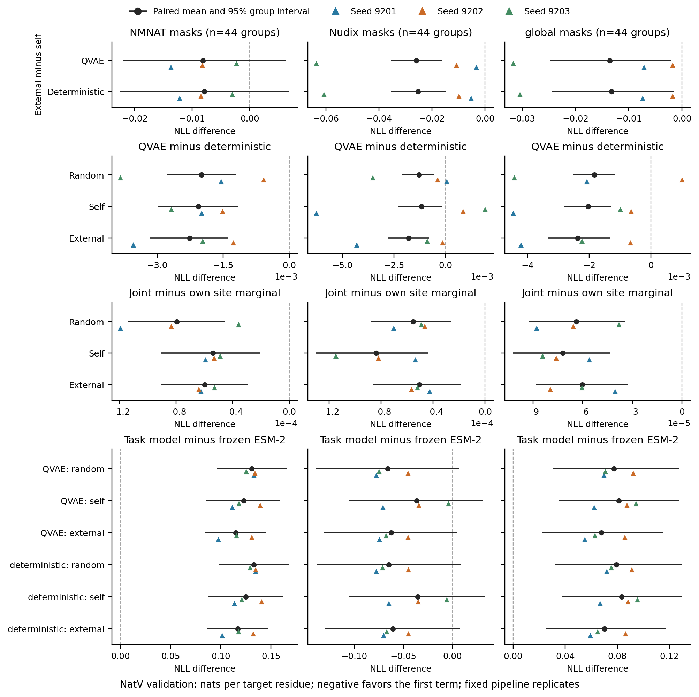

# NatV 六格条件预测比较

评价划分：validation。差值为比较名称中前项减后项，单位为 nats/目标残基；负值表示前项 NLL 较低。主要问题是 NMNAT 的 external − self；其他区域、模型差异、与冻结 ESM-2 的差异及交互项为补充比较。

图中黑点先在每个序列组内平均配对训练重复，再对组等权汇总；横线为组 bootstrap 95% 区间。彩色三角为各完整训练重复的组均值，不是新增独立序列组。区间以这些已拟合模型为条件，未覆盖训练随机性或作多重比较调整。

各图列仅显示该区域的掩码，global 不是全部掩码的加权总体。坐标范围随比较变化；约 10⁻⁴ 的 joint − marginal 差值须结合另行输出的 Monte Carlo 精度分析，不能由区间与零的关系直接解释为有用的生成依赖。

| 比较 | 区域 | 组数 | 平均差值 | 95% 组区间 |
| --- | --- | ---: | ---: | --- |
| random:QVAE_minus_deterministic | NMNAT | 44 | -0.00199177 | [-0.00277034, -0.00120404] |
| random:QVAE_minus_deterministic | Nudix | 44 | -0.00129060 | [-0.00212399, -0.00053707] |
| random:QVAE_minus_deterministic | global | 44 | -0.00183244 | [-0.00253001, -0.00116776] |
| random:QVAE_minus_deterministic | linker | 44 | -0.00044263 | [-0.00246761, +0.00159322] |
| random:QVAE_minus_deterministic | random | 44 | -0.00239700 | [-0.00303895, -0.00179007] |
| random:joint_minus_site_marginal | NMNAT | 44 | -0.00007956 | [-0.00011403, -0.00004547] |
| random:joint_minus_site_marginal | Nudix | 44 | -0.00005542 | [-0.00008792, -0.00002604] |
| random:joint_minus_site_marginal | global | 44 | -0.00006393 | [-0.00009277, -0.00003451] |
| random:joint_minus_site_marginal | linker | 44 | -0.00002581 | [-0.00009339, +0.00004057] |
| random:joint_minus_site_marginal | random | 44 | -0.00019819 | [-0.00024249, -0.00015414] |
| self:QVAE_minus_deterministic | NMNAT | 44 | -0.00206485 | [-0.00299148, -0.00116959] |
| self:QVAE_minus_deterministic | Nudix | 44 | -0.00117240 | [-0.00227673, -0.00016060] |
| self:QVAE_minus_deterministic | global | 44 | -0.00203453 | [-0.00281350, -0.00128271] |
| self:QVAE_minus_deterministic | linker | 44 | -0.00489584 | [-0.00739764, -0.00246252] |
| self:QVAE_minus_deterministic | random | 44 | -0.00228257 | [-0.00288570, -0.00169680] |
| self:joint_minus_site_marginal | NMNAT | 44 | -0.00005385 | [-0.00009056, -0.00002041] |
| self:joint_minus_site_marginal | Nudix | 44 | -0.00008366 | [-0.00012986, -0.00004350] |
| self:joint_minus_site_marginal | global | 44 | -0.00007218 | [-0.00010196, -0.00004315] |
| self:joint_minus_site_marginal | linker | 44 | -0.00003373 | [-0.00008684, +0.00001971] |
| self:joint_minus_site_marginal | random | 44 | -0.00021716 | [-0.00027257, -0.00016751] |
| external:QVAE_minus_deterministic | NMNAT | 44 | -0.00226464 | [-0.00315844, -0.00139296] |
| external:QVAE_minus_deterministic | Nudix | 44 | -0.00178567 | [-0.00277885, -0.00081314] |
| external:QVAE_minus_deterministic | global | 44 | -0.00237098 | [-0.00333387, -0.00132150] |
| external:QVAE_minus_deterministic | linker | 44 | -0.00278037 | [-0.00554829, -0.00019988] |
| external:QVAE_minus_deterministic | random | 44 | -0.00196908 | [-0.00260441, -0.00128044] |
| external:joint_minus_site_marginal | NMNAT | 44 | -0.00005983 | [-0.00009049, -0.00002927] |
| external:joint_minus_site_marginal | Nudix | 44 | -0.00005050 | [-0.00008601, -0.00001841] |
| external:joint_minus_site_marginal | global | 44 | -0.00006021 | [-0.00008808, -0.00003280] |
| external:joint_minus_site_marginal | linker | 44 | -0.00003946 | [-0.00009642, +0.00001483] |
| external:joint_minus_site_marginal | random | 44 | -0.00015449 | [-0.00019709, -0.00011099] |
| QVAE:external_minus_self | NMNAT | 44 | -0.00811670 | [-0.02208588, +0.00624318] |
| QVAE:external_minus_self | Nudix | 44 | -0.02598439 | [-0.03548831, -0.01607392] |
| QVAE:external_minus_self | global | 44 | -0.01355273 | [-0.02474987, -0.00195643] |
| QVAE:external_minus_self | linker | 44 | -0.00173994 | [-0.02027823, +0.01536434] |
| QVAE:external_minus_self | random | 44 | -0.00880847 | [-0.01526404, -0.00234975] |
| QVAE:self_minus_random | NMNAT | 44 | -0.00801174 | [-0.02215422, +0.00623768] |
| QVAE:self_minus_random | Nudix | 44 | +0.02950821 | [+0.01625477, +0.04433298] |
| QVAE:self_minus_random | global | 44 | +0.00376993 | [-0.01154512, +0.01939912] |
| QVAE:self_minus_random | linker | 44 | +0.00851418 | [-0.02246371, +0.04063118] |
| QVAE:self_minus_random | random | 44 | +0.00130279 | [-0.00953674, +0.01184028] |
| QVAE:external_minus_random | NMNAT | 44 | -0.01612844 | [-0.03105039, -0.00218150] |
| QVAE:external_minus_random | Nudix | 44 | +0.00352382 | [-0.01044220, +0.01830889] |
| QVAE:external_minus_random | global | 44 | -0.00978280 | [-0.02062971, +0.00245716] |
| QVAE:external_minus_random | linker | 44 | +0.00677425 | [-0.02652494, +0.03799718] |
| QVAE:external_minus_random | random | 44 | -0.00750569 | [-0.01617175, +0.00084718] |
| QVAE:random_minus_frozen_esm2 | NMNAT | 44 | +0.13077307 | [+0.09596540, +0.16608889] |
| QVAE:random_minus_frozen_esm2 | Nudix | 44 | -0.06609802 | [-0.13878431, +0.00724971] |
| QVAE:random_minus_frozen_esm2 | global | 44 | +0.07754762 | [+0.03050012, +0.12725993] |
| QVAE:random_minus_frozen_esm2 | linker | 44 | -0.04805578 | [-0.14017389, +0.04532668] |
| QVAE:random_minus_frozen_esm2 | random | 44 | +0.04915673 | [+0.00869887, +0.08890078] |
| QVAE:self_minus_frozen_esm2 | NMNAT | 44 | +0.12276132 | [+0.08492135, +0.15918611] |
| QVAE:self_minus_frozen_esm2 | Nudix | 44 | -0.03658980 | [-0.10564540, +0.03086845] |
| QVAE:self_minus_frozen_esm2 | global | 44 | +0.08131756 | [+0.03513835, +0.12755007] |
| QVAE:self_minus_frozen_esm2 | linker | 44 | -0.03954160 | [-0.12450667, +0.04805089] |
| QVAE:self_minus_frozen_esm2 | random | 44 | +0.05045952 | [+0.01215476, +0.08986488] |
| QVAE:external_minus_frozen_esm2 | NMNAT | 44 | +0.11464463 | [+0.08439679, +0.14486411] |
| QVAE:external_minus_frozen_esm2 | Nudix | 44 | -0.06257419 | [-0.13066359, +0.00454424] |
| QVAE:external_minus_frozen_esm2 | global | 44 | +0.06776482 | [+0.02227546, +0.11517453] |
| QVAE:external_minus_frozen_esm2 | linker | 44 | -0.04128154 | [-0.12338728, +0.04282487] |
| QVAE:external_minus_frozen_esm2 | random | 44 | +0.04165104 | [+0.00457393, +0.07974959] |
| deterministic:external_minus_self | NMNAT | 44 | -0.00791691 | [-0.02249168, +0.00687693] |
| deterministic:external_minus_self | Nudix | 44 | -0.02537112 | [-0.03551391, -0.01498420] |
| deterministic:external_minus_self | global | 44 | -0.01321629 | [-0.02436189, -0.00156578] |
| deterministic:external_minus_self | linker | 44 | -0.00385541 | [-0.02273523, +0.01347181] |
| deterministic:external_minus_self | random | 44 | -0.00912197 | [-0.01548826, -0.00267895] |
| deterministic:self_minus_random | NMNAT | 44 | -0.00793866 | [-0.02249895, +0.00670374] |
| deterministic:self_minus_random | Nudix | 44 | +0.02939001 | [+0.01605913, +0.04415007] |
| deterministic:self_minus_random | global | 44 | +0.00397202 | [-0.01127435, +0.01954993] |
| deterministic:self_minus_random | linker | 44 | +0.01296739 | [-0.01883045, +0.04516028] |
| deterministic:self_minus_random | random | 44 | +0.00118836 | [-0.00972166, +0.01155501] |
| deterministic:external_minus_random | NMNAT | 44 | -0.01585557 | [-0.03095239, -0.00170420] |
| deterministic:external_minus_random | Nudix | 44 | +0.00401889 | [-0.00985954, +0.01838193] |
| deterministic:external_minus_random | global | 44 | -0.00924426 | [-0.01999775, +0.00290611] |
| deterministic:external_minus_random | linker | 44 | +0.00911198 | [-0.02395960, +0.04055969] |
| deterministic:external_minus_random | random | 44 | -0.00793361 | [-0.01661693, +0.00016525] |
| deterministic:random_minus_frozen_esm2 | NMNAT | 44 | +0.13276484 | [+0.09779448, +0.16816513] |
| deterministic:random_minus_frozen_esm2 | Nudix | 44 | -0.06480742 | [-0.13809086, +0.00889107] |
| deterministic:random_minus_frozen_esm2 | global | 44 | +0.07938006 | [+0.03195342, +0.12932889] |
| deterministic:random_minus_frozen_esm2 | linker | 44 | -0.04761315 | [-0.13924197, +0.04513986] |
| deterministic:random_minus_frozen_esm2 | random | 44 | +0.05155373 | [+0.01095482, +0.09139324] |
| deterministic:self_minus_frozen_esm2 | NMNAT | 44 | +0.12482617 | [+0.08720375, +0.16156729] |
| deterministic:self_minus_frozen_esm2 | Nudix | 44 | -0.03541741 | [-0.10500650, +0.03318782] |
| deterministic:self_minus_frozen_esm2 | global | 44 | +0.08335209 | [+0.03711897, +0.12981409] |
| deterministic:self_minus_frozen_esm2 | linker | 44 | -0.03464576 | [-0.12076539, +0.05436378] |
| deterministic:self_minus_frozen_esm2 | random | 44 | +0.05274209 | [+0.01396298, +0.09247233] |
| deterministic:external_minus_frozen_esm2 | NMNAT | 44 | +0.11690927 | [+0.08674638, +0.14724110] |
| deterministic:external_minus_frozen_esm2 | Nudix | 44 | -0.06078852 | [-0.12950179, +0.00740125] |
| deterministic:external_minus_frozen_esm2 | global | 44 | +0.07013580 | [+0.02495089, +0.11777337] |
| deterministic:external_minus_frozen_esm2 | linker | 44 | -0.03850117 | [-0.12175907, +0.04736995] |
| deterministic:external_minus_frozen_esm2 | random | 44 | +0.04362012 | [+0.00671892, +0.08166653] |
| external_minus_self:QVAE_minus_deterministic | NMNAT | 44 | -0.00019979 | [-0.00152502, +0.00115708] |
| external_minus_self:QVAE_minus_deterministic | Nudix | 44 | -0.00061327 | [-0.00193777, +0.00064984] |
| external_minus_self:QVAE_minus_deterministic | global | 44 | -0.00033644 | [-0.00150789, +0.00085539] |
| external_minus_self:QVAE_minus_deterministic | linker | 44 | +0.00211547 | [-0.00137886, +0.00555435] |
| external_minus_self:QVAE_minus_deterministic | random | 44 | +0.00031349 | [-0.00052040, +0.00119194] |

全部相似性与位点数分层、空层及单组层见 summary.json；逐组配对差值见 paired_group_differences.csv。prediction_effects.csv 保留全部相似性、全部位点数范围内的区域估计和逐种子结果，其中 linker、random 及模型交互项列于本表，但未绘入主图。

自身减随机与外部减随机的分层对照，是观察到 QVAE 验证总体区域差异后补充的探索性参照；用于区分自身预训练的退化与外部相对随机基线的改善，不替代预定主要比较。

- Intervals condition on three fitted pipeline replicates; seed differences are shown separately.
- Components may occur in multiple strata; strata are not independent studies. Empty strata have no estimate; one-component strata have no interval.
- Size/identity strata and model/latent contrasts are supplementary, without multiplicity adjustment.
- Stratified self-minus-random and external-minus-random contrasts were added after examining aggregate QVAE validation regional scores; they are exploratory reference comparisons.
- Small joint-minus-marginal differences need Monte Carlo error assessment before interpretation.
