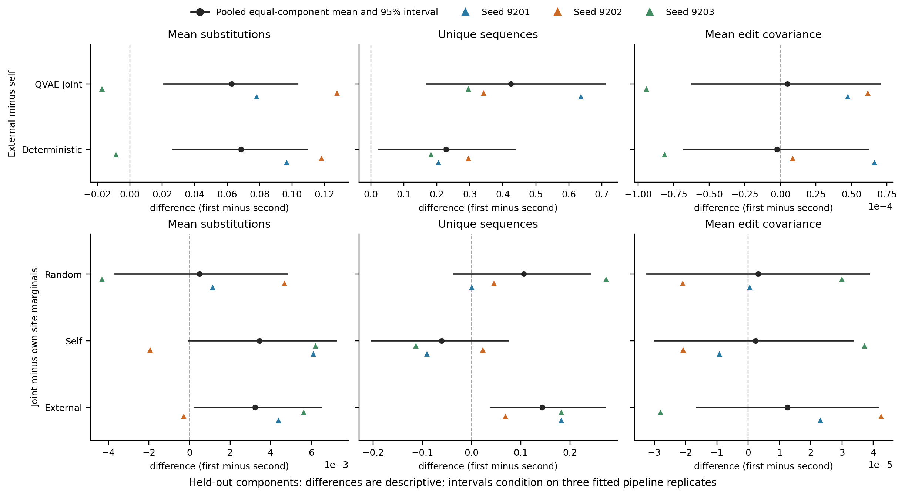

# NatV 六格条件生成比较

评价对象：44 个 held-out component 代表序列，加 KVP40 应用背景（KVP40 不是第 45 个 component）。每个背景 6 个 NMNAT 掩码（8、16、32 位各 2 个），每个掩码 64 次抽样，温度 1；每背景 384 次、每个 fitted-model distribution 17280 次、27 个 run 共 466560 次核验尝试。

差值为比较名称中前项减后项。Hamming 差值先在每背景的 384 次尝试上取平均替换数，再对 held-out component 等权；unique 差值是每背景 384 次尝试中不同整序列数之差；pair covariance 差值先对每掩码每对用 64 次抽样计算 E[I_i I_j]−E[I_i]E[I_j]，再对 6 个掩码的全部 1,288 个位点对等权（大掩码贡献更多对，不是每掩码等权）。pooled 值先在同 component 内平均三个下游 seed，再对 component 等权。区间是固定三个 fitted pipeline replicate 后的 equal-component bootstrap。逐 seed 三角是三个完整训练重复，不是独立生物样本。

编辑数均值、唯一序列数和配对编辑协方差是描述量。编辑数只依赖逐位点边缘，不能据此证明共享潜变量的联合建模收益；唯一序列数接近抽样上限时区分力有限；协方差是掩码内位点对的经验描述，不是因果或功能指标。差异不自动表示生物质量、活性或候选优劣。

## 原始总体与 Hamming 匹配

`run_summary.csv` 保留每个背景/run 的原始总体（未跨 component 汇总）；本报告只读取已保存的 `component_effects.csv` 和 `hamming_paired.csv`，没有重采样或重新评分。
Hamming 匹配在每个 background/seed/mask/stratum 内独立抽样，每侧取 n=min(n_left,n_right)，保持相等尝试预算；空层为 NA，丢弃量见 `discarded_left/right`。本报告累计 611074 个匹配对、32077 个空层、32077 个 unique 差值 NA、丢弃计数合计 22012；这些是多个比较条目复用同一批候选的累计抽样计数，不是互不重叠的候选总数，也不是独立蛋白或生物学重复。

## 候选距离

候选距离使用背景序列的固定 stable alignment 映射：BLOSUM62、open gap −10、extend gap −0.5、max_optimal 来自 config，双方 stable coverage ≥0.80；候选编辑替换到固定映射后，对所有合格训练参考取最小值。`edit_mismatch_fraction` 描述候选编辑位点上候选与最近对齐训练参考的差异，不是以编辑位点单独重新搜索的最近邻，也不因候选编辑重新对齐。

## Held-out component 估计

| 比较 | 标签 | metric | 平均差值 | 95% 区间 | components |
| --- | --- | --- | ---: | --- | ---: |
| External minus self | QVAE joint | Mean substitutions | +0.06283539 | [+0.02068882, +0.10379676] | 44 |
| External minus self | QVAE joint | Unique sequences | +0.42424242 | [+0.16666667, +0.71212121] | 44 |
| External minus self | QVAE joint | Mean edit covariance | +0.00000484 | [-0.00006278, +0.00007082] | 44 |
| External minus self | Deterministic | Mean substitutions | +0.06857639 | [+0.02635683, +0.10988844] | 44 |
| External minus self | Deterministic | Unique sequences | +0.22727273 | [+0.02272727, +0.43958333] | 44 |
| External minus self | Deterministic | Mean edit covariance | -0.00000235 | [-0.00006864, +0.00006225] | 44 |
| Joint minus own site marginals | Random | Mean substitutions | +0.00049321 | [-0.00370896, +0.00483398] | 44 |
| Joint minus own site marginals | Random | Unique sequences | +0.10606061 | [-0.03787879, +0.24261364] | 44 |
| Joint minus own site marginals | Random | Mean edit covariance | +0.00000312 | [-0.00003256, +0.00003903] | 44 |
| Joint minus own site marginals | Self | Mean substitutions | +0.00345249 | [-0.00009864, +0.00726010] | 44 |
| Joint minus own site marginals | Self | Unique sequences | -0.06060606 | [-0.20454545, +0.07575758] | 44 |
| Joint minus own site marginals | Self | Mean edit covariance | +0.00000236 | [-0.00003024, +0.00003376] | 44 |
| Joint minus own site marginals | External | Mean substitutions | +0.00323548 | [+0.00021652, +0.00653015] | 44 |
| Joint minus own site marginals | External | Unique sequences | +0.14393939 | [+0.03787879, +0.27272727] | 44 |
| Joint minus own site marginals | External | Mean edit covariance | +0.00001250 | [-0.00001660, +0.00004183] | 44 |

## KVP40 应用背景（单独报告，不进入 component 区间）

| 比较 | 标签 | metric | 逐 seed 均值 | pooled 均值 | 有效 seed | 区间 |
| --- | --- | --- | --- | ---: | ---: | --- |
| External minus self | QVAE joint | Mean substitutions | +0.20572917, +0.22656250, -0.31770833 | +0.03819444 | 3 | NA |
| External minus self | QVAE joint | Unique sequences | -1.00000000, +0.00000000, +0.00000000 | -0.33333333 | 3 | NA |
| External minus self | QVAE joint | Mean edit covariance | -0.00041682, -0.00038990, -0.00124042 | -0.00068238 | 3 | NA |
| External minus self | Deterministic | Mean substitutions | +0.25000000, +0.21875000, -0.26562500 | +0.06770833 | 3 | NA |
| External minus self | Deterministic | Unique sequences | -1.00000000, +0.00000000, +0.00000000 | -0.33333333 | 3 | NA |
| External minus self | Deterministic | Mean edit covariance | -0.00026215, -0.00010046, -0.00093884 | -0.00043382 | 3 | NA |
| Joint minus own site marginals | Random | Mean substitutions | -0.03125000, +0.04427083, -0.03125000 | -0.00607639 | 3 | NA |
| Joint minus own site marginals | Random | Unique sequences | +0.00000000, +0.00000000, -1.00000000 | -0.33333333 | 3 | NA |
| Joint minus own site marginals | Random | Mean edit covariance | -0.00016169, -0.00036413, +0.00020964 | -0.00010539 | 3 | NA |
| Joint minus own site marginals | Self | Mean substitutions | -0.02343750, +0.02864583, +0.02604167 | +0.01041667 | 3 | NA |
| Joint minus own site marginals | Self | Unique sequences | +0.00000000, +0.00000000, +0.00000000 | +0.00000000 | 3 | NA |
| Joint minus own site marginals | Self | Mean edit covariance | +0.00027068, +0.00001327, +0.00062267 | +0.00030221 | 3 | NA |
| Joint minus own site marginals | External | Mean substitutions | +0.02083333, -0.00520833, -0.00260417 | +0.00434028 | 3 | NA |
| Joint minus own site marginals | External | Unique sequences | -1.00000000, +0.00000000, +0.00000000 | -0.33333333 | 3 | NA |
| Joint minus own site marginals | External | Mean edit covariance | +0.00000209, +0.00007374, +0.00026461 | +0.00011348 | 3 | NA |

KVP40 是单一应用背景，不是独立 component；其区间不定义，pooled 值只平均有效 seed。KVP40 的逐 seed 差异不能当作 44 个 held-out component 的推断。

`generation_effects.csv` 保存本图使用的 pooled 与逐 seed 估计。全部比较、分层和 KVP40 记录见 `component_effects.csv`。
