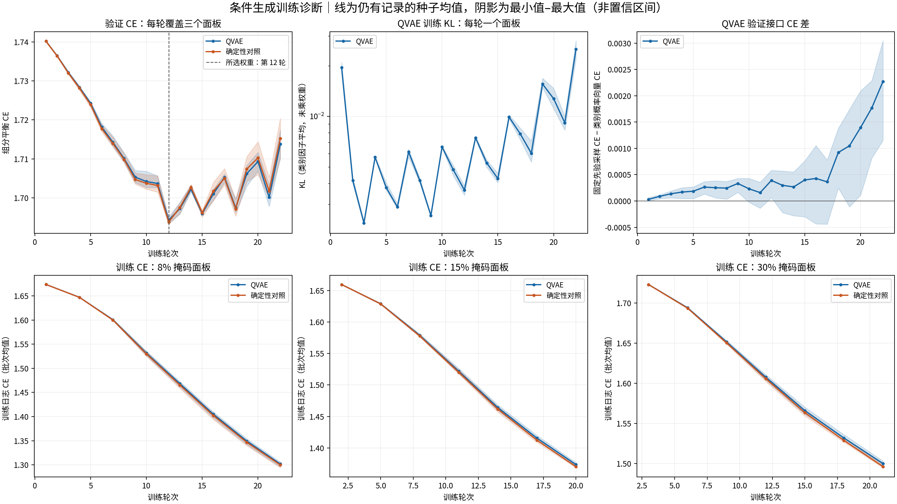
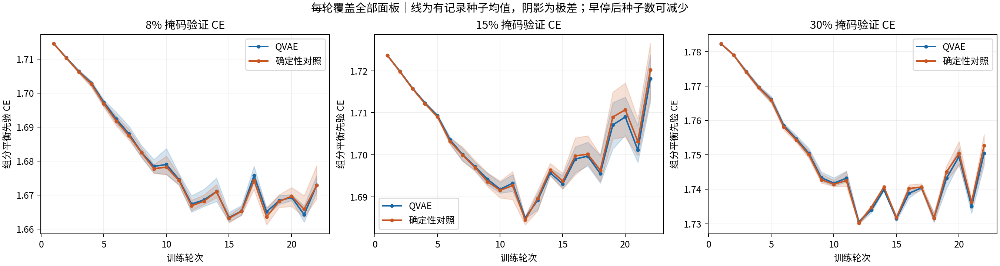

# 目标条件后验训练结果

六次从头拟合均在第 22 轮触发早停，最佳生成接口权重均为第 12 轮。修正后的 QVAE 先验验证 CE 未优于确定性对照；改变 z 可改变预测概率，因此不能把低 KL 解释为 z 完全不起作用，也不能据此认定其学到了有额外收益的家族联合变异规律。

## 运行与权重

训练提交为 `961dee9`，输入、冻结 ESM-2、模型源码及方案 SHA256 见 `inputs/identity.json`；掩码和 5,613 份缓存特征逐文件核验见 `inputs/cache_identity.json`。正式训练 1,644 条、验证 227 条；参数从头随机初始化，共同参数的配对种子初值相同。QVAE 为 764,948 参数，对照为 629,908 参数；目标条件后验的输入、额外参数及比较限制见 [PLAN.md](PLAN.md)。

一次执行完成六次拟合，无失败或重试。单卡 RTX 5090 D 的全流程耗时 216.14 秒（含输入核验及最佳权重诊断），低于 3,600 秒预算；该值是设备占用时段上界，不是实测 GPU 内核忙碌时间。实际完成 132 个模型轮次，见 `cost.json`、`fit_status.json` 与 `training_history.json`。每次连续 10 轮未改善后停止，未用满 100 轮上限。

六份最佳权重及 SHA256 见 `checkpoint_manifest.json`，文件位于 `data/models/kvp40_target_posterior_training/checkpoints/`。保存权重的内部轮次、验证值及文件哈希均通过核对。

## 训练与验证曲线

线为三个配对种子的均值，阴影为最小值至最大值，不是置信区间；[PDF](training_curves.pdf) 可用于导出。训练曲线按 8%/15%/30% 轮换面板分别绘制。

| 三个种子均值 | QVAE | 确定性对照 |
|---|---:|---:|
| 最佳权重轮次 | 12 | 12 |
| 最佳先验验证 CE | 1.694288 | 1.693807 |
| 最佳权重验证 CE 种子范围 | 1.693392–1.695152 | 1.693263–1.694667 |
| 第 22 轮先验验证 CE | 1.713834 | 1.715262 |
| 第 12 轮训练 CE | 1.607573 | 1.605694 |
| 第 22 轮训练 CE | 1.301879 | 1.299919 |

第 12 轮后总体出现训练 CE 下降、验证 CE 回升，早停避免了继续延长相同配置。训练 CE 日志按批次样本数汇总组分加权损失，旧运行则对批次均值等权平均，二者的训练曲线数值不能直接比较；训练批次和优化目标保持一致。确定性对照在前 22 轮的验证 CE 与旧运行逐种子、逐轮完全一致。

每轮验证始终覆盖全部面板。第 12 轮 QVAE 的 8%/15%/30% 面板 CE 分别为 1.667354 / 1.684959 / 1.730551，对照为 1.666835 / 1.684471 / 1.730116；各面板均未显示一致的 QVAE 优势。面板最优轮次可以不同，实际权重按事先约定的合并验证 CE 选择。

## 潜变量的实际作用

最佳权重的 QVAE 验证先验 CE 为 1.694288，固定后验采样 CE 为 1.693866，后验概率均值 CE 为 1.693898。训练使用软 Gumbel-Softmax，而先验与后验抽样评价使用 one-hot 编码；三种接口的差别应按方案解释。先验到后验采样的平均差仅约 0.000422，不能将目标条件后验的重构表现当作生成收益。

第 12 轮训练 KL 为 0.003653，验证 KL 为 0.005360，均按类别因子平均且未乘损失系数。按验证输入等权描述，三个种子、32 个因子的后验条件熵均值为 2.074151 nats，接近均匀上限 `ln(8)=2.079442`；汇总分布熵减条件熵均值为 0.003547。类别分布仍接近均匀，不能把 argmax 类别出现次数当作采样使用率。完整逐因子摘要保存在逐轮记录中。

在各自第 12 轮权重上，对相同 24 个固定验证输入比较八个先验 z，结果见 `latent_sensitivity.json`：

| 训练种子 | 相对第一个 z 的平均 TV | 遮蔽位置 argmax 不同的比例 |
|---|---:|---:|
| 20261021 | 0.01160 | 2.22% |
| 20261022 | 0.01279 | 2.77% |
| 20261023 | 0.01174 | 2.66% |

TV 为每个遮蔽位置的氨基酸概率分布总变差距离，跨其余七个 z 与全部遮蔽位置平均。此结果说明先验 z 对输出有非零影响；输入是按 ID 排序的前八条验证序列及三个面板，并非随机代表整个家族，也不等于最终完整序列分布或设计价值。

## 核验与恢复

`training_diagnostics.json` 从 89,892 条逐输入验证记录重新计算 132 组整体 CE、面板 CE 和验证 KL，并核对早停计数、图件及权重。完整验证记录位于 `data/results/kvp40_target_posterior_training/raw/validation_records.jsonl.gz`；掩码与特征清单位于同目录，实际特征复用原缓存而未复制。

执行命令与输入约定见 [PLAN.md](PLAN.md)。重现此次计算应使用记录的训练提交、同版本环境、输入与缓存哈希，并另建运行目录以保留本次结果；绘图命令为 `PYTHONDONTWRITEBYTECODE=1 /home/yhshy/miniconda3/envs/nad_data/bin/python scripts/plot_conditional_training.py --run experiments/kvp40_target_posterior_training`。旧报告、权重、完整候选及哈希快照保留，9.7 GB 缓存是本轮复用输入。

运行末次清单中的 `output.log` 哈希对应终态消息写入前的日志前缀，不能校验最终日志；该快照保留。正式指标和权重以本节独立核验为依据，后续入口已排除仍在写入的日志。
