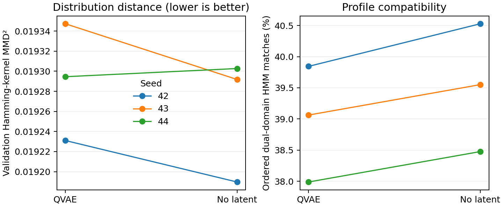

# WT 对齐列先验生成比较

按正式训练 1,644 条、验证 227 条完成旧 `SequenceGenerator` 的重新训练与先验生成。六次训练和 6,144 次原始采样均完成；当前比较未显示离散潜变量相对无潜变量对照的明确生成优势。

## 任务与比较

任务、数据含义与预定比较方式见 `PLAN.md`、`plan.json`；指标的估计与 HMM 阈值见 `evaluation_protocol.json`。QVAE 与对照均有 776,981 个参数，同一配对种子的初始参数相同，各自独立优化，读取同样的抽样记录和掩码。对照仅编码固定 WT，输出确定性条件分布；QVAE 训练后验读取被遮蔽的目标，但先验生成只依赖 z 和共同 WT 条件。

本轮实际使用 RTX 5090 D，六次训练均 20 epoch、520 次更新，共 3,120 次更新。checkpoint 的最佳 epoch 分别为 QVAE 6/8/8、对照 5/5/5。`training/checkpoint_freeze.json` 绑定权重路径、SHA256 和实际训练步数；`training/identity.json` 绑定本轮代码、计划、数据和旧来源记录。

输入由旧对齐算法从允许使用的序列重新整理，保留 60,178 个插入残基的位置；这些残基不进入 341 列输出。训练 47 个组分等权，验证 44 个组分等权。数据对应及校验值见 `data/input_checks.json`，逐序列映射见 `data/aligned_samples.jsonl`。现役划分的来源见 `../../docs/DATA_PROVENANCE.md`。

## 原始生成结果

每个模型、每个种子均为 1,024 次尝试；全部提案参与统计。

| 模型 | seed | Hamming kernel MMD² ↓ | 提案间平均 Hamming 比例 | 有序双结构域 HMM 命中 / 1,024 |
|---|---:|---:|---:|---:|
| QVAE | 42 | 0.019231 | 0.584805 | 408 |
| 无潜变量 | 42 | 0.019190 | 0.593610 | 415 |
| QVAE | 43 | 0.019347 | 0.571258 | 400 |
| 无潜变量 | 43 | 0.019292 | 0.579080 | 405 |
| QVAE | 44 | 0.019295 | 0.579348 | 389 |
| 无潜变量 | 44 | 0.019303 | 0.580458 | 394 |

主要指标的 QVAE−对照配对平均差为 +0.00002954，开发条件下 95% 重采样区间为 [−0.00001933, +0.00008488]；较低的 MMD² 较好，当前结果不足以区分优势。双结构域 HMM 命中为 QVAE 1,197/3,072（38.96%）、对照 1,214/3,072（39.52%）。HMM 命中只表示给定阈值下的结构域 profile 相容性。

6,144 条对齐字符串及去 gap 序列均不重复；与训练和验证的原始序列精确匹配均为 0。该新颖性比较不包含测试序列。QVAE 平均去 gap 长度 319.53 aa（293–337），对照 322.87 aa（307–336）；所有提案均含 gap。相对 WT 的平均对齐列变化数分别为 213.97 与 215.11，因此本轮确实探索了广泛组合，而非固定少数位点编辑。

## 解释与决定

完整先验采样能力已在本轮实际使用，但当前数据、目标与模型下未建立潜变量的生成收益。优先保留无潜变量模型作为本任务的简洁统计参照，不据较低的训练后验重构或验证负 ELBO 宣称 QVAE 生成更好，也不自动扩展 Continuous MMD-VAE 训练。

这批产物尚非工程化候选库。对齐列模型学习了 gap，直接去 gap 会缩短序列，不能据 HMM 命中认定其 NMNAT 催化组织、结构域相对组织或 NAD⁺ 净积累得到保留。下一轮应先明确工程候选是否要求保留 WT 长度和骨架，再确定如何处理 gap、插入与大范围替换，并将原始采样与设计约束后的提案分开评价。

本轮使用已有历史暴露的验证集选择 checkpoint 和比较生成分布；三个种子和组分重采样区间只描述这一开发任务，未提供独立确认。MMD² 的有限样本和固定带宽只检验此处定义的分布差异，不等于蛋白功能；实验活性与候选自身结构仍为 UNKNOWN。

## 产物与复现

- `evaluation/raw_candidates.csv`：全部原始提案、对齐及去 gap 序列、z、长度、来源精确匹配与结构域注释。
- `evaluation/raw_ungapped.fasta`：全部去 gap 序列。
- `evaluation/per_seed_summary.csv`、`results.json`：逐模型种子统计、主要指标和重采样区间。
- `evaluation/domain_hits.csv`：两个 profile 的命中、覆盖度与判定。
- `evaluation/identity.json`、`artifact_hashes.json`：评价代码、协议及输出校验值。
- `training/*/model_best.pt`：存放于本机 `/home/yhshy/git_files/natvqvae/experiments/natv_wt_columns/training/` 的六份 checkpoint；大文件不纳入 Git，校验值见冻结记录。

从项目根目录使用 `/home/yhshy/miniconda3/envs/nad_data/bin/python` 执行 `experiments/natv_wt_columns/run.py prepare`、`train`、`evaluate`。依赖与版本见训练 identity、`../../discovery/natv_data_readiness/data_checks.json` 及评价记录的 pyhmmer 版本。现有输出目录会拒绝覆盖；复现须在隔离的项目副本中保留同一代码、计划与只读源路径，先将该副本内本轮的 `data/`、`training/`、`evaluation/` 目录移至副本外保存，再依次执行三阶段；`--root` 可指定旧来源路径。
